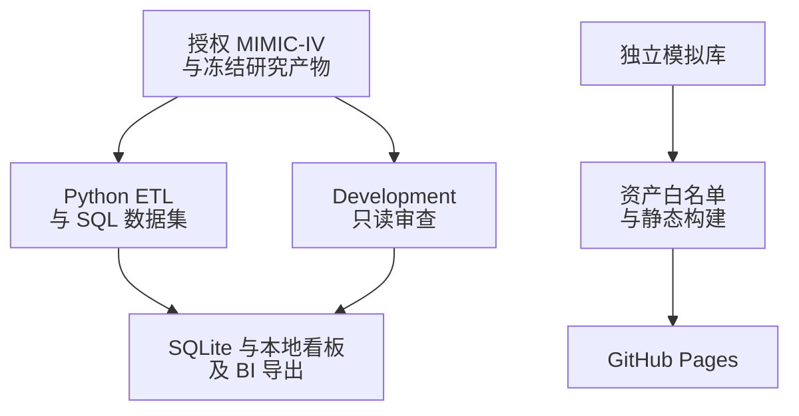

# 基于 MIMIC-IV 的临床数据研究与智能预测分析平台

**Clinical Research and Intelligent Prediction Platform Based on MIMIC-IV**

个人研究与工程实践。围绕 ICU 入科后 90 天死亡风险，把研究设计、临床数据治理、患者级分组、统计分析、动态预测及结果解释连成可追溯的研究流程。适用于临床研究和医疗数据分析岗位展示。临床应用尚未开展。

**English abstract.** A retrospective ICU research portfolio using credentialed MIMIC-IV 3.1 data. It documents cohort definitions, patient-level validation, descriptive and exploratory association analyses, and time-specific prediction evaluation. The interactive public demonstration uses independently generated synthetic data.

[在线演示（已发布版本）](https://huhu-0026.github.io/icu-outcomes-analytics/) · [研究设计](docs/public/research_design.md) · [统计分析计划](docs/public/statistical_analysis_plan.md) · [项目验收](docs/acceptance_report.md)


| 能力 | 可验证成果 |
|---|---|
| 临床研究 | PICOTS、队列与结局定义、索引停留 Table 1、标准化差异、探索性调整 OR 和敏感性分析 |
| 医学数据 | MIMIC 表关系、时间可得性、变量字典、分块 ETL、统计分母与完整性检查 |
| 医学 AI | 冻结的 Logistic / LSTM / Isotonic 实验、患者五折 OOF、ROC / PR / Brier / MCC、分组历史贡献 |




研究设计的对象、模型对比、结局、时点和验证范围见 [PICOTS 和研究时间轴](docs/public/research_design.md)。公开仓库展示研究设计、实现与模拟界面。真实 Table 1、系数、曲线和解释在授权本地环境读取。


## 运行

Python 3.11 或 3.12。展示预置模拟库及构建 Pages 只需标准库。

```powershell
python app.py serve --mode demo --open
python scripts/build_pages.py
python -m unittest discover -s tests -v
```

打开 `dist/pages/index.html` 预览新版静态站。未部署的功能分支与在线已发布版本有版本差异。重建分析或测试 ETL 用 `python -m pip install -r requirements.txt`。安装 Node 后可执行浏览器汇总与 SQL 一致性测试。

具有授权数据、冻结完整项目及本地分析库的研究人员可运行 `review-research` 生成一个新输出目录，再通过 `serve --mode mimic --database … --research-dir …` 加载。参数示例、版本和证据见 [模型开发与本地复现](docs/public/model_development.md)。

| 位置 | 内容 |
|---|---|
| `icu_analytics/`、`sql/` | ETL、数据模型、统计、只读研究分析 |
| `web/`、`scripts/build_pages.py` | 七页看板、公开静态构建 |
| `powerbi/` | CSV 接入、Power Query、DAX |
| `tests/`、`.github/workflows/` | 统计、数据、HTTP、Pages 与自动化验证 |
| `docs/`、`docs/public/` | 审查、设计、SAP、指标、答辩与验收 |

使用 Python、SQLite、SQL、JavaScript、Matplotlib，分析依赖含 NumPy、Pandas、scikit-learn 和 statsmodels。历史 LSTM 在本地冻结研究环境使用 PyTorch。

**研究边界。** 单中心回顾性 Development 内部验证，历史 Test 已暴露。日期级结局、选择性风险集、变量缺失及残余混杂限制外推。现有结果属于方法适配。原文 19 项未恢复的变量、SAPS III 对照和外部验证仍待完成。实验代码与权重的证据层级见 [模型评价](docs/public/model_evaluation.md)。

数据为 [MIMIC-IV 3.1](https://physionet.org/content/mimiciv/3.1/)。公开演示只含独立模拟数据与明确标记的图表。真实原始记录、逐人预测、模型权重和本地汇总不在公开包内。代码许可与归属见 [LICENSE](LICENSE) 和 [NOTICE](NOTICE.md)。[PhysioNet 数据使用协议](https://physionet.org/content/mimiciv/view-dua/3.1/)
