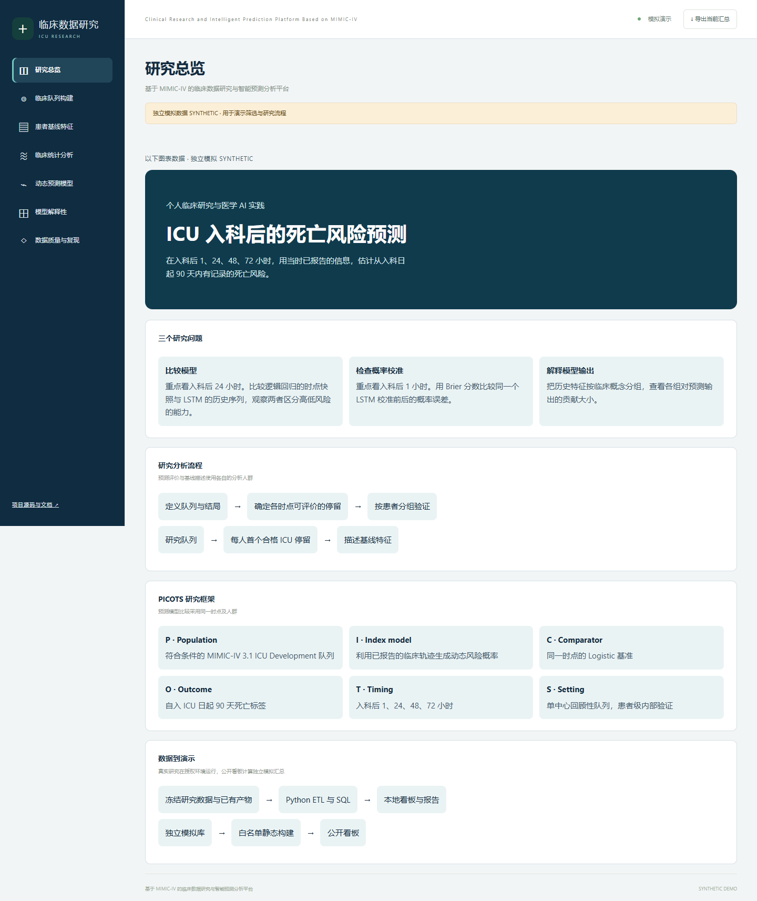
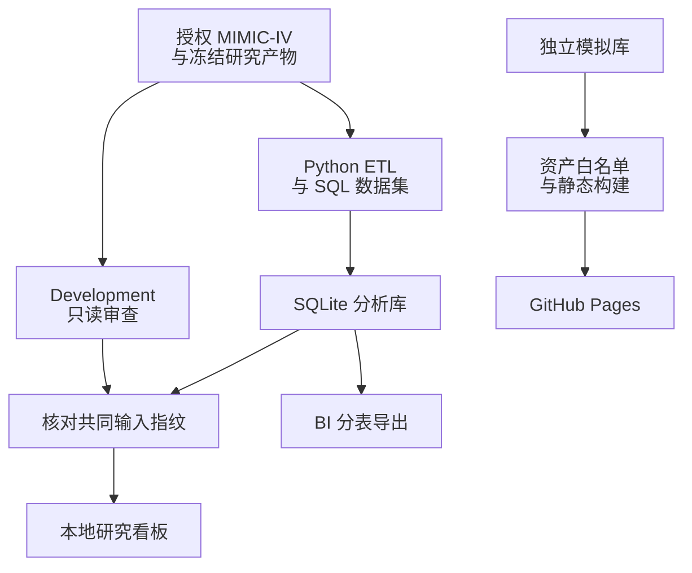
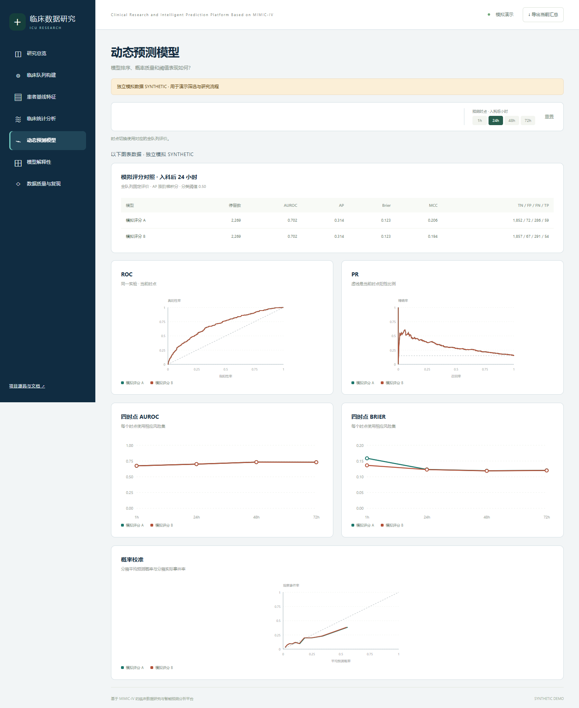

# 基于 MIMIC-IV 的临床数据研究与智能预测分析平台

**Clinical Research and Intelligent Prediction Platform Based on MIMIC-IV**

这是我在学习临床研究和医学 AI 过程中完成的个人项目。我用 MIMIC-IV 3.1 练习把一个临床问题转成可核查的分析，并实现了数据整理、结果复算和交互展示。

**研究问题**是在 ICU 入科后 1、24、48、72 小时，能否用当时已报告的信息，估计从入科日起 90 天内有记录的死亡风险？每次评价只纳入该时点仍符合条件的 ICU 停留。

- **比较模型**：重点看入科后 24 小时。比较逻辑回归的时点快照和 LSTM 的历史序列，观察两者区分高低风险的能力。
- **检查概率校准**：重点看入科后 1 小时。在相同的验证人群中，用 Brier 分数衡量同一个 LSTM 校准前后的概率误差。
- **解释模型输出**：把历史特征按临床概念分组，查看各组对预测输出的贡献大小。

队列和基线分析说明每项结果对应哪些患者和 ICU 停留。具体做法见 [模型比较、校准与解释](docs/public/model_development.md)。

**English abstract.** A personal clinical research and engineering project on ICU landmark prediction using MIMIC-IV 3.1. This repository contains a synthetic interactive demo and tools for checking frozen results in a credentialed environment. Historical cohort construction, feature generation and model training are documented in a separate local project.

[在线演示（模拟数据）](https://huhu-0026.github.io/icu-outcomes-analytics/) · [项目概览](docs/public/project_overview.md) · [队列与时间轴](docs/public/research_design.md) · [数据字典](docs/public/data_dictionary.md) · [模型方法](docs/public/model_development.md) · [统计分析计划](docs/public/statistical_analysis_plan.md)

[](https://huhu-0026.github.io/icu-outcomes-analytics/)

| 证据范围 | 可查看或运行的内容 |
|---|---|
| 公开仓库 | 研究设计与数据口径、Python/SQL 分析实现、测试，以及可运行的七页独立模拟看板 |
| 授权本地运行 | 导入冻结 Development 和相关源表，构建 SQLite 分析库。另可复算折外评价、生成 Table 1、探索性调整分析和图表 |
| 历史研究项目 | 入排 SQL、时点特征生成、训练和校准代码、权重、折外预测及真实结果。公开文档记录其方法和边界 |



研究设计、队列分支与预测时间轴见 [PICOTS 和研究时间轴](docs/public/research_design.md)。公开页面的评分和贡献值来自模拟演示。真实研究产物在授权环境内查看。



## 运行

Python 3.11 或 3.12。展示预置模拟库及构建 Pages 只需标准库。

```powershell
python app.py serve --mode demo --open
python scripts/build_pages.py
python -m unittest discover -s tests -v
```

打开 `dist/pages/index.html` 预览当前检出的静态站。重建分析或测试 ETL 用 `python -m pip install -r requirements.txt`。安装 Node 后可执行浏览器汇总与 SQL 一致性测试。

具有授权数据和冻结研究项目的读者可运行 `build-mimic` 和 `review-research`，再通过 `serve --mode mimic --database … --research-dir …` 加载同一批输入生成的产物。参数示例和旧产物处理见 [模型开发与本地复算](docs/public/model_development.md)。

| 位置 | 内容 |
|---|---|
| `icu_analytics/`、`sql/` | ETL、数据模型、统计、只读研究分析 |
| `web/`、`scripts/build_pages.py` | 七页看板、公开静态构建 |
| `powerbi/` | CSV 接入、Power Query、DAX |
| `tests/`、`.github/workflows/` | 统计、数据、HTTP、Pages 与自动化验证 |
| `docs/`、`docs/public/` | 研究设计、统计计划、数据字典、实验记录与验收 |

使用 Python、SQLite、SQL、JavaScript、Matplotlib，分析依赖含 NumPy、Pandas、scikit-learn 和 statsmodels。历史 LSTM 在本地冻结研究环境使用 PyTorch。

**研究边界。** 单中心回顾性 Development 内部验证，历史 Test 已暴露。日期级结局、选择性风险集、变量缺失及残余混杂限制外推。现有结果属于方法适配。原文 19 项未恢复的变量、SAPS III 对照和外部验证仍待完成。实验代码与权重的证据层级见 [模型评价](docs/public/model_evaluation.md)。

数据为 [MIMIC-IV 3.1](https://physionet.org/content/mimiciv/3.1/)。公开演示只含独立模拟数据与明确标记的图表。真实原始记录、逐人预测、模型权重和本地汇总不在公开包内。代码许可与归属见 [LICENSE](LICENSE) 和 [NOTICE](NOTICE.md)。[PhysioNet 数据使用协议](https://physionet.org/content/mimiciv/view-dua/3.1/)
