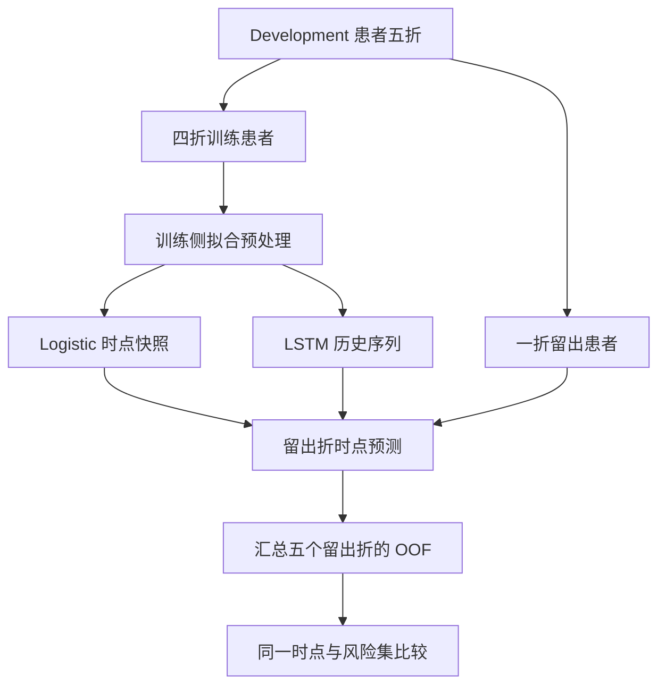
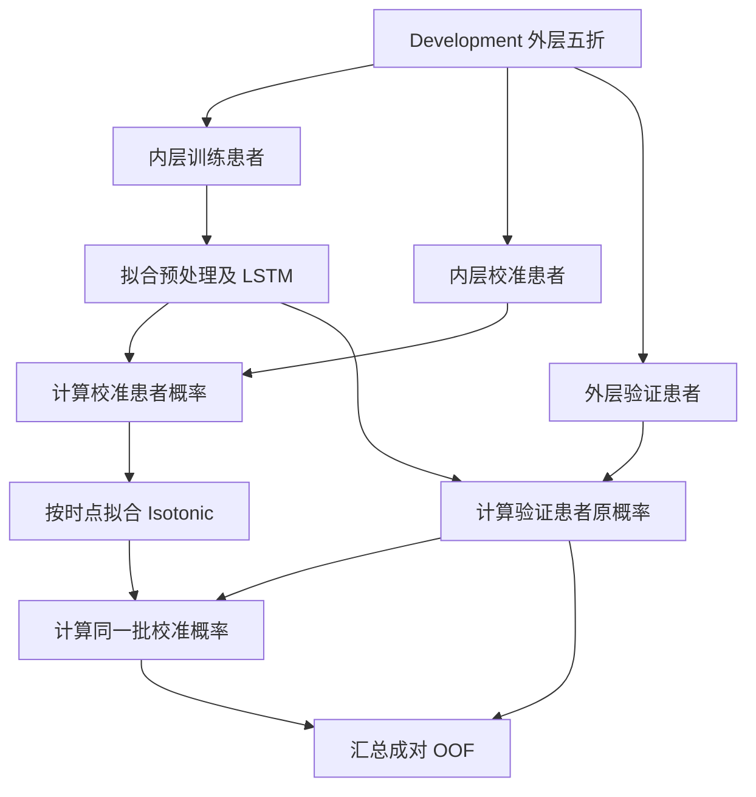

# 模型开发与本地复现

本页记录本地完整研究项目的实验方法。公开仓库提供独立模拟演示，并在授权环境中读取保存下来的预测和结果表，核对和复算评价指标。

## 编号怎么来的

简写 `v03` 到 `v06` 来自 2026 年 11 月 12 日的研究方案。数字沿用各方案的版本号，和本地交付目录的排序编号属于两套命名。现存的修正版方案已使用 `v03`，其中没有记录选择数字 03 的理由。

| 研究阶段 | 原方案版本名 | 当时的改动 |
|---|---|---|
| 特征重建和模型比较（v03） | `corrected_core25_v03` | 沿用原开发队列和患者分折，重新从源表提取特征并修正时点可得性。用修正后的特征训练逻辑回归和 LSTM，主要比较 24 小时。 |
| 独立患者概率校准（v04） | `v04_grouped_holdout_isotonic_calibration` | 沿用 v03 特征和外层分折，把训练患者、校准患者和留出验证患者分开。比较本轮训练的同一 LSTM 校准前后的概率，重点看首小时。 |
| 初版分组解释（v05） | `v05_grouped_feature_history_shapley` | 使用训练侧聚类中心附近的真实轨迹作参照。后续核查发现这组参照低估训练人群的平均预测风险，因此该版留作历史记录。 |
| 修正版分组解释（v06） | `v06_grouped_history_probability_stratified_reference` | 改为按预测概率分层抽取训练侧真实轨迹作为参照，并重算贡献。沿用 v04 的网络和校准器，保留 v05 已选定的解释对象。 |

2026 年 11 月 18 日整理研究证据时，才追溯登记以下长编号。例如 `M4-LR-V03-20261112` 中，`LR` 对应逻辑回归，`V03` 和 `20261112` 对应原研究版本和日期。编号用于把方案、结果与核验记录对应起来。

| 研究任务 | 追溯登记编号 | 当前证据 |
|---|---|---|
| 核心特征重建 | `M4-FEAT-V03-20261112` | 25 个原尺度变量槽位，通气阳性和未知分别编码后构成 26 列模型输入。 |
| 时点快照模型 | `M4-LR-V03-20261112` | 每时点×五折的 20 个 L2 Logistic。四时点快照，主要比较时点为 24 小时。 |
| 历史序列模型 | `M4-LSTM-V03-20261112` | 五个单向 LSTM。固定 16 个隐藏单元、四轮训练，使用有效时长标记。 |
| 同一网络的概率校准 | `M4-CAL-V04-20261112` | 五折各自划分训练、校准和折外验证患者。每折四个 Isotonic 映射，主要比较首小时的 Brier。 |
| 历史特征分组解释 | `M4-EXPL-V06-20261112` | 13 组历史特征贡献，抽样来自外层验证折，参照来自训练患者。 |

## 模型比较 · v03

历史序列最多使用入科后前 72 小时，各时点评价使用对应风险集。连续量填补和缩放的参数仅在各折训练范围内拟合。



每位患者的预测来自留出该患者的折。v03 的主要对比时点为 24 小时，其余时点用于观察结果随风险集的变化。

## 同一网络的概率校准 · v04



概率校准以首小时 Brier 为重点，同时保留各时点的其他评价指标。

## 历史特征分组解释 · v06

把一起解释的临床变量及其历史记录归为一组，用分组 Shapley 估计各组对模型输出的贡献。抽样来自外层验证患者，参照来自对应网络的训练患者。看板按组展示平均绝对贡献，单位为概率百分点。

## 本地归档的位置

以下路径相对于授权本地项目 `MIMIC_IV_Complete_Replication_20261112` 的根目录。这是独立于当前 GitHub 仓库的研究归档。

| 本地目录 | 内容与公开仓库的关系 |
|---|---|
| `03_队列与特征工程/analysis` | 保存 v03 冻结特征方案、队列和两类模型的折外预测。此仓库读取队列与折外预测并复算指标。 |
| `05_独立患者校准/analysis` | 保存 v04 校准方案及同一网络校准前后的折外预测。此仓库读取这两套概率。 |
| `06_解释与稳定性/analysis` | 保存 v06 解释计算和核验。此仓库使用下一行的汇总贡献表。 |
| `07_最终报告与英文图表/03_tables` | 保存正式结果表，其中包括 v06 的 `group_importance.csv`。此仓库读取这些表并核对复算结果。 |
| `11_项目治理与方法审查/phase2_20261118` | 保存追溯登记的 `experiment_registry.csv`、`authority_registry.json` 和产物指纹。 |

公开仓库可直接查看 [输入路径](../../icu_analytics/research_inputs.py) 和 [复算实现](../../icu_analytics/research.py)，其中的相对路径在传入本地项目根目录后解析。

## 授权本地复算

安装 requirements 后使用 PowerShell。将占位路径替换为本机目录，选择新的输出目录。

```powershell
python app.py build-mimic --project "D:/本地完整复现项目"
python app.py review-research --project "D:/本地完整复现项目" --output "validation/新的研究目录"
python app.py serve --mode mimic --research-dir "validation/新的研究目录" --open
```

`review-research` 对照阶段二登记的 SHA256 和保存的索引复算 OOF 指标，生成聚合报告以及 PNG/SVG，并拟合一套探索性统计 GLM。历史预测模型训练保存在授权本地研究项目。

同时加载分析库和研究汇总时，程序逐文件比较冻结队列、人口与科室源表、v04 折外文件、模型结果表、校准、缺失率和分组贡献表的 SHA256。两份产物需要从同一批共同输入生成。已有完整指纹的分析库可通过 `--database` 指定。旧分析库可单独打开基础看板，合并展示前需要重建缺少指纹的产物。

[评价方法](model_evaluation.md) · [统计计划](statistical_analysis_plan.md)
