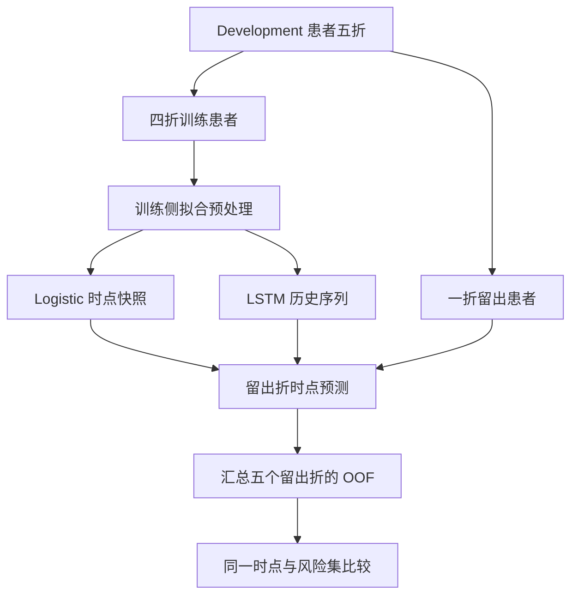
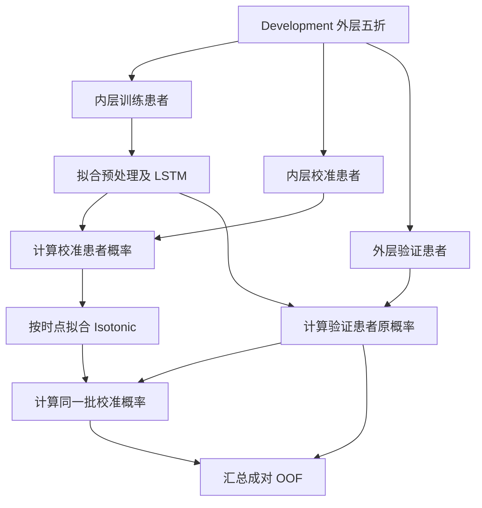

# 模型开发与本地复现

历史研究使用入科后前 72 小时的序列。25 个临床槽位形成 26 列模型输入。连续量的填补和缩放参数在各折训练范围内拟合，通气阳性和未知分别编码。各时点评价使用相应风险集，特征可得性以测量时间、报告时间和预测时点为准。

项目沿用本地研究归档里的实验编号，便于将方法、模型和结果表对应起来。v03、v04、v06 分别对应模型比较、概率校准和模型解释。

| 研究任务 | 归档编号 | 当前证据 |
|---|---|---|
| 时点快照模型 | `M4-LR-V03-20261112` | 每时点×五折的 20 个 L2 Logistic。四时点快照，主要比较时点为 24 小时。 |
| 历史序列模型 | `M4-LSTM-V03-20261112` | 五个单向 LSTM。固定 16 个隐藏单元、四轮训练，使用有效时长标记。 |
| 同一网络的概率校准 | `M4-CAL-V04-20261112` | 五折各自划分训练、校准和折外验证患者。每折四个 Isotonic 映射，主要比较首小时的 Brier。 |
| 历史特征分组解释 | `M4-EXPL-V06-20261112` | 13 组历史特征贡献，抽样来自外层验证折，参照来自训练患者。 |

## 模型比较 · v03



每位患者的预测来自留出该患者的折。v03 的主要对比时点为 24 小时，其余时点用于观察结果随风险集的变化。

## 同一网络的概率校准 · v04



概率校准以首小时 Brier 为重点，同时保留各时点的其他评价指标。

## 历史特征分组解释 · v06

把一起解释的临床变量及其历史记录归为一组，用分组 Shapley 估计各组对模型输出的贡献。抽样来自外层验证患者，参照来自对应网络的训练患者。看板按组展示平均绝对贡献，单位为概率百分点。

以上流程记录授权本地项目的历史方法。第 03、05、06 章保存模型及核验产物，第 07 章保存结果表。本仓库导入这些冻结产物，并提供只读复算。

## 授权本地复算

安装 requirements 后使用 PowerShell。将占位路径替换为本机目录，选择新的输出目录。

```powershell
python app.py build-mimic --project "D:/本地完整复现项目"
python app.py review-research --project "D:/本地完整复现项目" --output "validation/新的研究目录"
python app.py serve --mode mimic --research-dir "validation/新的研究目录" --open
```

`review-research` 对照阶段二登记的 SHA256 和保存的索引复算 OOF 指标，生成聚合报告以及 PNG/SVG，并拟合一套探索性统计 GLM。历史预测模型训练保存在授权本地研究项目。

同时加载分析库和研究汇总时，程序逐文件比较冻结队列、人口与科室源表、v04 折外文件、模型结果表、校准、缺失率和分组贡献表的 SHA256。两份产物需要从同一批共同输入生成。已有完整指纹的分析库可通过 `--database` 指定。旧分析库可单独打开基础看板，合并展示前需要重建缺少指纹的产物。

[评价方法](model_evaluation.md) · [统计计划](statistical_analysis_plan.md)
