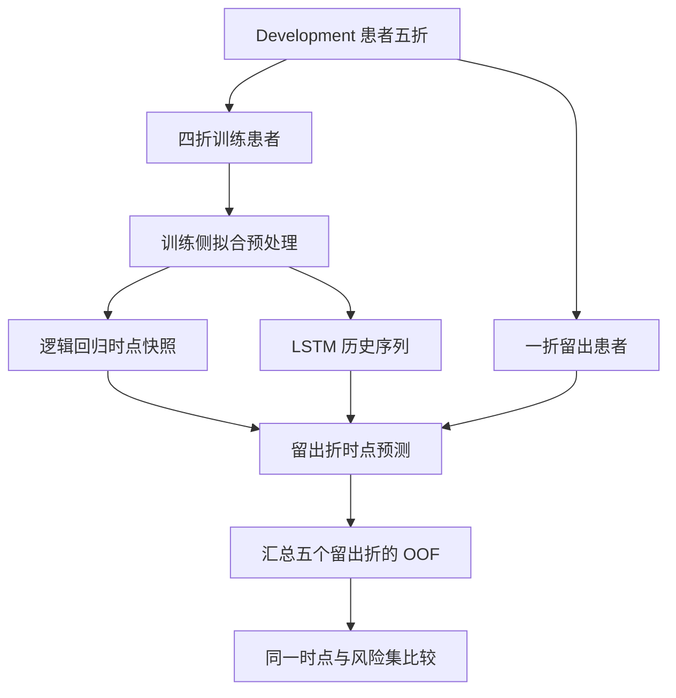
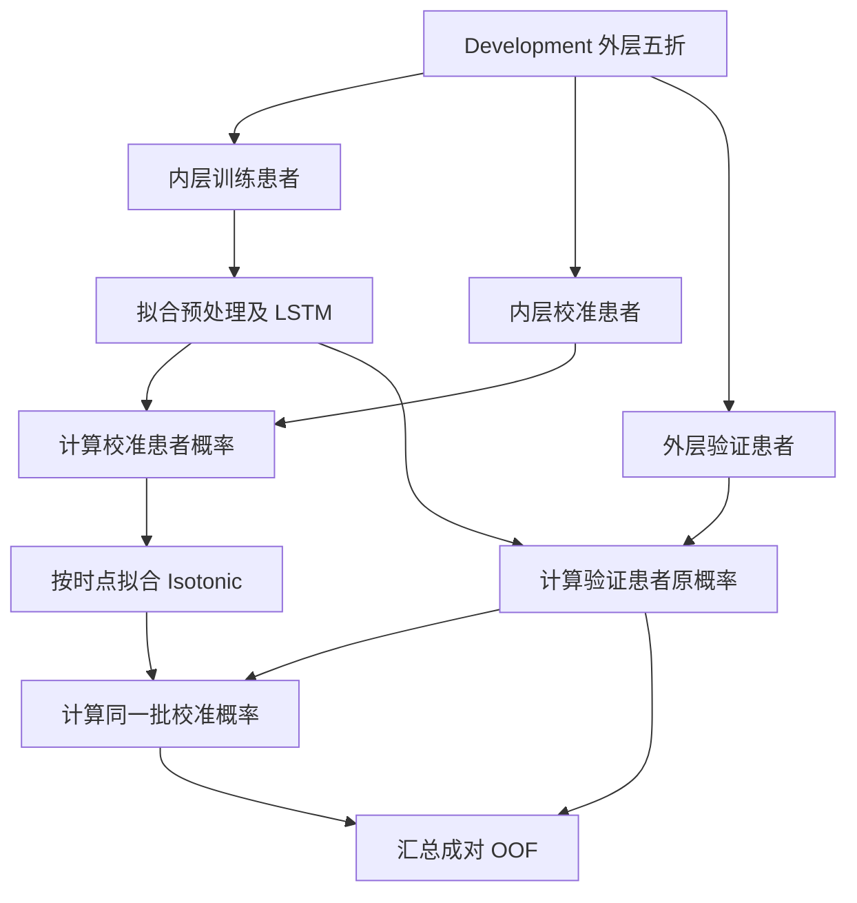

# 模型比较、概率校准与分组特征解释

本页记录本地完整研究项目的实验方法。公开仓库提供独立模拟演示，并在授权环境中读取保存下来的预测和结果表，核对和复算评价指标。

## 模型比较：时点快照与历史序列

历史序列最多使用入科后前 72 小时，各时点评价使用对应风险集。连续量填补和缩放的参数仅在各折训练范围内拟合。

研究从源表重新提取预测时已可得的特征。25 个原尺度变量槽位经预处理形成 26 列模型输入，其中通气阳性和未知分别编码。逻辑回归在四个时点各训练五折，共 20 个模型。LSTM 每折训练一个单向网络，共五个。每个网络有 16 个隐藏单元，固定训练四轮。字段定义见 [数据字典](data_dictionary.md#模型特征)。



每位患者的预测来自留出该患者的折。主要对比时点为入科后 24 小时，其余时点用于观察结果随风险集的变化。

## 概率校准：比较同一网络的原概率和校准概率

校准研究沿用模型比较的特征和患者外层分折。每折单独划出训练、校准和留出验证患者，在训练侧拟合 LSTM，在校准侧按时点拟合 Isotonic 映射，最后在留出侧比较该网络校准前后的概率。五折共拟合五个网络和 20 个映射。



概率校准以首小时 Brier 为重点，同时保留各时点的其他评价指标。

## 分组特征解释：哪些历史信息对预测有贡献

把相关临床变量及其历史记录归为一组，用分组 Shapley 估计 13 组特征对模型输出的贡献。解释对象抽自外层验证患者，参照来自对应网络的训练患者。看板按组展示平均绝对贡献，单位为概率百分点。

初次分析从聚类中心附近选参照，核查发现这会低估训练人群的平均预测风险。随后按预测概率分层抽取训练侧真实轨迹并重算贡献，沿用同一批解释对象、网络和校准器。

## 公开演示与授权数据

公开演示使用独立模拟数据展示如何阅读模型曲线和贡献图。真实研究的队列、模型训练和逐条预测保存在授权环境。本仓库的本地分析入口读取已保存的队列、折外预测及结果表，可复算模型比较和概率校准的指标。分组解释在看板使用已汇总的贡献值。具体输入见 [数据读取实现](../../icu_analytics/research_inputs.py) 和 [指标复算实现](../../icu_analytics/research.py)。

## 授权本地复算

安装 requirements 后使用 PowerShell。将占位路径替换为本机目录，选择新的输出目录。

```powershell
python app.py build-mimic --project "D:/本地完整复现项目"
python app.py review-research --project "D:/本地完整复现项目" --output "validation/新的研究目录"
python app.py serve --mode mimic --research-dir "validation/新的研究目录" --open
```

`review-research` 核对输入文件的 SHA256 和保存的索引，复算折外预测指标，生成汇总报告和图表，并拟合探索性统计回归。

同时加载分析库和研究汇总时，程序逐文件比较研究队列、人口与科室源表、校准前后的折外预测，以及模型评价、缺失率和分组贡献表的 SHA256。两份产物需要从同一批共同输入生成。已有完整指纹的分析库可通过 `--database` 指定。旧分析库可单独打开基础看板，合并展示前需要重建缺少指纹的产物。

[评价方法](model_evaluation.md) · [统计计划](statistical_analysis_plan.md)
