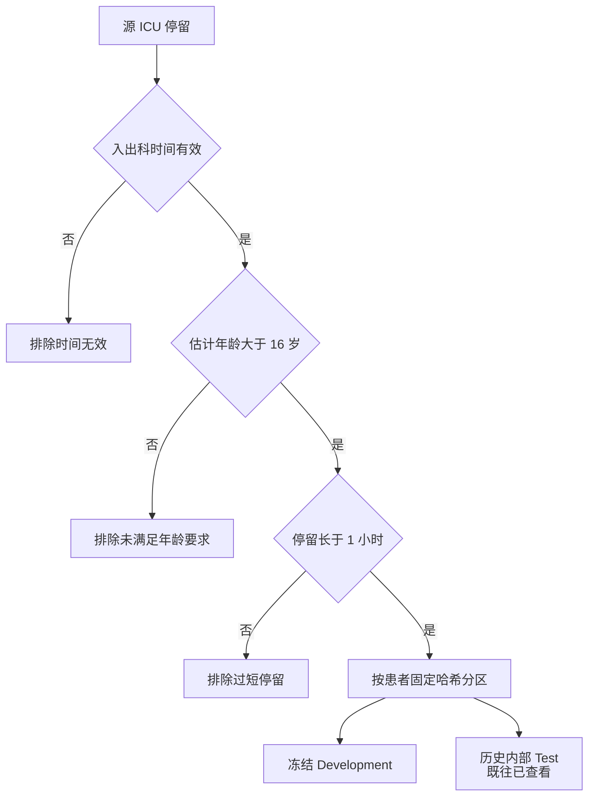
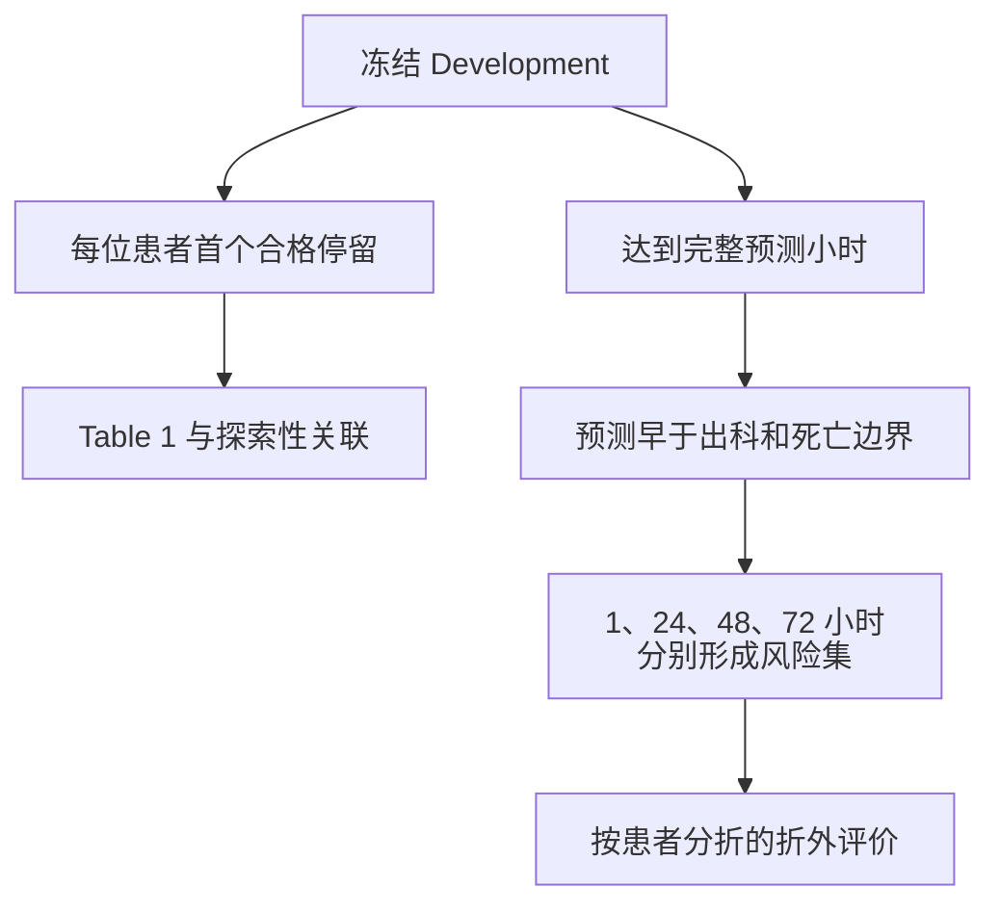

# 研究设计与 PICOTS

ICU 入科早期数据会持续到达。对每个仍符合条件的 ICU 停留，本项目用预测时已报告的信息，估计从入科日计的 90 天内有记录的死亡风险。四个预测时点共用入科日起算的结局定义，各自使用对应的风险集。

| PICOTS | 本地研究定义 |
|---|---|
| Population | MIMIC-IV 3.1 ICU 的冻结 Development。来源 SQL 要求入出科有效、估计年龄 >16、停留 >1 小时 |
| Index model | 使用可得的历史序列预测概率的单向 LSTM |
| Comparator | 同一时点的 Logistic 快照。另设同一网络原概率与 Isotonic 概率对比 |
| Outcome | 死亡日期落在入 ICU 日至该日加 90 天的闭区间。标签 0 表示窗口内无已记录死亡，包含 DOD 缺失 |
| Timing | 入 ICU 为研究起点。预测时点为 1、24、48、72 小时 |
| Setting | 单中心回顾性 EHR、患者级内部交叉验证 |

v03 主要比较 24 小时的折外排序。观察到早期概率校准问题后，v04 将首小时 Brier 设为同网络校准比较的重点。这些是回顾性项目中的探索性比较。本文档追溯记录其设计。

## 队列纳排与患者分区

同一患者的多次停留进入同一分区。当前分析使用冻结 Development。历史 Test 已在既往研究中查看。纳排和风险集逐层计数保留在授权本地报告，公开演示的队列规模来自独立模拟库。

## Development 的分析分支

每个时点只使用在预测前测量、且在预测时已报告的事件。时点成员要达到对应完整小时，并且预测时刻早于出科和死亡边界。历史规则将仅记录死亡日期者的排除边界设在该日零点。结局窗口以入科日为起点，不随预测时点后移。随访可观察性限制标签 0 的解释。

[实验流程](model_development.md) · [统计分析计划](statistical_analysis_plan.md) · [变量字典](data_dictionary.md)
