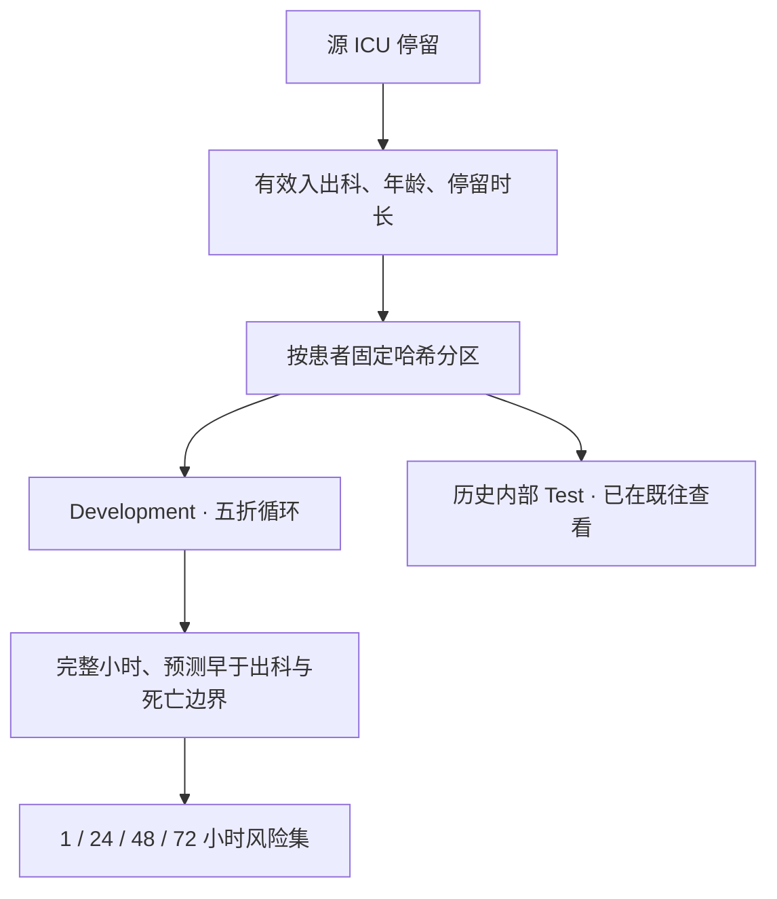

# 研究设计与 PICOTS

ICU 入科早期数据会持续到达。我们研究已报告临床信息能否帮助估计从入 ICU 日算起的 90 天死亡风险，以及概率在早期时点的误差。研究目的是问清谁可被预测、当时可用什么、预测表现如何。

| PICOTS | 本地研究定义 |
|---|---|
| Population | MIMIC-IV 3.1 ICU 的冻结 Development。来源 SQL 要求入出科有效、估计年龄 >16、停留 >1 小时 |
| Index model | 使用可得的历史序列预测概率的单向 LSTM |
| Comparator | 同一时点的 Logistic 快照。另设同一网络原概率与 Isotonic 概率对比 |
| Outcome | 死亡日期落在入 ICU 日至该日加 90 天的闭区间。DOD 缺失按历史定义为标签 0 |
| Timing | 入 ICU 为研究起点。预测时点为 1、24、48、72 小时 |
| Setting | 单中心回顾性 EHR、患者级内部交叉验证 |

探索性假设包括 LSTM 折外排序在 24 小时表现出差异，首小时概率校准可以降低 Brier。v04 的首小时来自已见的 v03 早期校准问题。本文件追溯记录研究设计，独立预注册证据未确立。

该图展示队列规则。已在授权环境核验全源 ICU 纳排、冻结 Development 的时点成员及已记录死亡的日期边界。逐层计数和敏感性结果保留在本地报告。公开图中的计数来自独立模拟库。

**研究时间轴** 入科 → 已测量且已报告的事件 → 到达预测时点 → 按入科日追溯结局窗口。每个时点使用仍满足历史出科和死亡边界的停留。仅有死亡日期时，旧规则从该日零点排除。该保守约定及随访可观察性应在后续新协议中明确。

[统计分析计划](statistical_analysis_plan.md) · [变量字典](data_dictionary.md)
